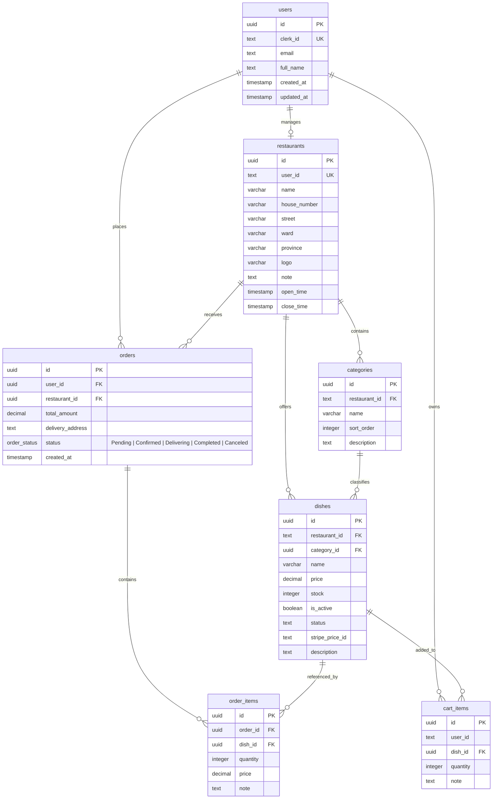
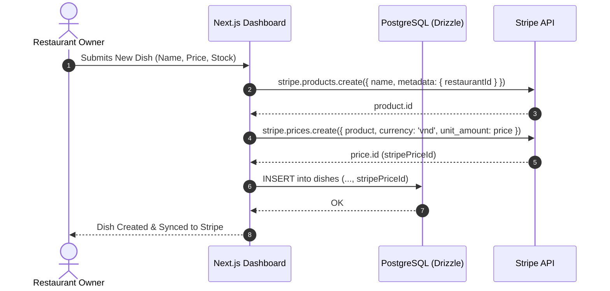
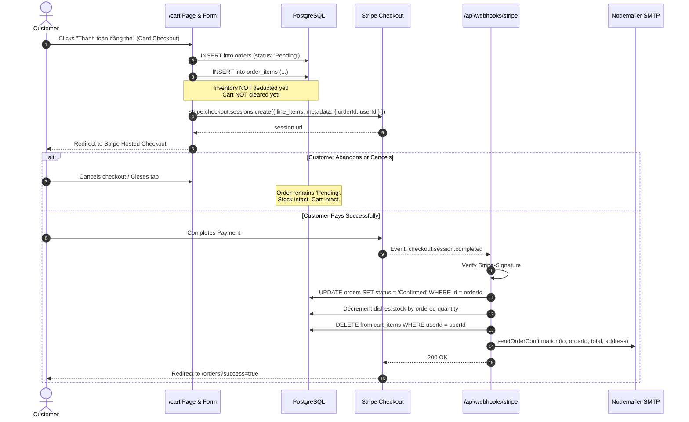

# 🍔 Food Delivery App

A production-ready, full-stack food delivery and restaurant management platform built with **Next.js 16 (App Router)**, **React 19**, **Drizzle ORM**, **PostgreSQL**, **Stripe**, **Clerk Authentication**, and **next-intl**.

---

## 📖 Table of Contents

- [Overview](#-overview)
- [Key Features](#-key-features)
- [Tech Stack](#-tech-stack)
- [Project Architecture & Directory Structure](#-project-architecture--directory-structure)
- [Database Schema](#-database-schema)
- [Getting Started & Installation](#-getting-started--installation)
  - [Prerequisites](#prerequisites)
  - [Installation](#1-clone-and-install-dependencies)
  - [Environment Configuration](#2-configure-environment-variables)
  - [Database Setup & Migration](#3-database-setup-and-seeding)
  - [Running the Application](#4-run-the-development-server)
  - [Stripe Webhook Configuration (Stripe CLI)](#5-configure-stripe-webhook-with-stripe-cli)
- [Core Business Workflows](#-core-business-workflows)
  - [1. Cart Management & User Auto-Provisioning](#1-cart-management--user-auto-provisioning)
  - [2. Stripe Catalog Product Synchronization](#2-stripe-catalog-product-synchronization)
  - [3. Pending Order & Anti-Race Condition Checkout Flow](#3-pending-order--anti-race-condition-checkout-flow)
  - [4. Order Retry / Re-Payment Mechanism](#4-order-retry--re-payment-mechanism)
  - [5. Restaurant Order Fulfillment](#5-restaurant-order-fulfillment)
  - [6. Internationalization (i18n)](#6-internationalization-i18n)
- [API Endpoints Reference](#-api-endpoints-reference)
- [Scripts Reference](#-scripts-reference)
- [License](#-license)

---

## 🌟 Overview

**Food Delivery App** bridges the gap between hungry customers and local culinary partners. Customers can explore partner restaurants, search for favorite dishes, customize and maintain a persistent shopping cart, and execute seamless payments via Stripe. 

Simultaneously, restaurant owners have access to a dedicated merchant management dashboard to register eateries, create categories, manage food inventories, synchronize items directly with Stripe Catalog, and process incoming customer orders in real-time.

---

## ✨ Key Features

- **Multi-Restaurant Marketplace**: Discover restaurants, browse curated menus categorized by courses, and search dishes dynamically with debounced queries.
- **Persistent Multi-Device Cart**: Hybrid cart state synchronized between client-side **Zustand** store and database-backed `cart_items` table.
- **Stripe Catalog Synchronization**: Automatic bidirectional provisioning of Stripe Products and Prices when dishes are created, updated, or deleted by restaurant owners.
- **Race-Condition-Safe Checkout**: Orders start in a `Pending` state. Restaurant inventory is only decremented and carts are only cleared upon cryptographically verified Stripe Webhook execution.
- **Order Retry / Re-Payment**: Incomplete or abandoned checkouts remain safely in `Pending` status, allowing customers to resume payment anytime from the Order History page.
- **Automated Transactional Emails**: Instant HTML order confirmation receipts sent via **Nodemailer SMTP** as soon as payments are confirmed.
- **Clerk Authentication & Svix Webhooks**: Secure user identity lifecycle with automatic Postgres user synchronization on login and registration.
- **Bilingual Internationalization (i18n)**: Instant switching between **Vietnamese (vi)** and **English (en)** preserved across sessions via cookies.
- **Vietnam Administrative Address Selector**: Hierarchical province, district, and ward selector integrated into the checkout flow.

---

## 🛠 Tech Stack

| Domain | Technology / Library | Version | Description |
| :--- | :--- | :--- | :--- |
| **Framework** | [Next.js](https://nextjs.org/) | `16.3.0` | React Framework with App Router, Server Components & Server Actions |
| **Frontend UI** | [React](https://react.dev/) | `19.2.8` | Component architecture & modern hooks |
| **Styling** | [Tailwind CSS](https://tailwindcss.com/) | `4.x` | Modern utility-first CSS styling engine |
| **UI Components** | [Ant Design](https://ant.design/) | `6.6.3` | Notification messages, modals, and interaction helpers |
| **Database** | [PostgreSQL (Neon)](https://neon.tech/) | Cloud / 16+ | Serverless cloud relational database |
| **ORM & Migrations** | [Drizzle ORM](https://orm.drizzle.team/) & [Drizzle Kit](https://orm.drizzle.team/kit-docs/overview) | `0.45.2` / `0.31.10` | TypeScript-first ORM with migration toolkit |
| **Database Driver** | [postgres](https://github.com/porsager/postgres) | `3.4.9` | High-performance PostgreSQL client |
| **Authentication** | [@clerk/nextjs](https://clerk.com/) | `7.6.5` | User management, session handling, and social login |
| **Webhook Security** | [Svix](https://svix.com/) | `2.0.0` | Clerk webhook signature verification |
| **Payment Gateway** | [Stripe](https://stripe.com/) | `22.6.2` | Hosted Stripe Checkout sessions and Stripe Catalog API |
| **State Management** | [Zustand](https://zustand-demo.pmnd.rs/) | `5.0.14` | Lightweight reactive client-side store |
| **Validation** | [Zod](https://zod.dev/) | `4.6.5` | Schema declaration and input validation |
| **Internationalization** | [next-intl](https://next-intl-docs.vercel.app/) | `4.14.6` | App Router request-scoped localization |
| **Email Service** | [Nodemailer](https://nodemailer.com/) | `10.0.10` | Transactional email delivery via SMTP |
| **ID Generation** | [uuidv7](https://github.com/kripod/uuidv7) | `1.2.1` | Time-sortable UUID v7 identifiers |

---

## 📂 Project Architecture & Directory Structure

```
food-delivery-app/
├── app/                           # Next.js App Router root
│   ├── actions/                   # Next.js Server Actions
│   │   └── payment.ts             # Server Action for payment retries & lazy Stripe sync
│   ├── api/                       # REST API route handlers
│   │   ├── cart/                  # GET (fetch user cart) & POST (add/update cart items)
│   │   ├── checkout/              # POST: Creates initial order in Pending status
│   │   ├── foods/                 # Query endpoints for foods/dishes
│   │   ├── restaurant/            # Restaurant management endpoints
│   │   │   ├── categories/        # GET & POST for restaurant categories
│   │   │   ├── dishes/            # POST: Create dish & sync to Stripe Catalog
│   │   │   ├── orders/update/     # PATCH: Update order status (Delivering, Completed)
│   │   │   └── register/          # POST: Onboard new restaurant
│   │   ├── sync-user/             # POST: Manual sync between Clerk user & Postgres
│   │   └── webhooks/              # Incoming webhook listeners
│   │       ├── clerk/             # Handles user.created & user.updated (Svix verified)
│   │       └── stripe/            # Handles checkout.session.completed (Stripe signature verified)
│   ├── cart/                      # Shopping Cart & Checkout view
│   │   ├── page.tsx               # Cart page (Server Component) with stock checks
│   │   ├── CartItemQuantity.tsx   # Quantity stepper component
│   │   └── CheckoutForm.tsx       # Vietnam administrative address picker & checkout trigger
│   ├── foods/                     # Food & Restaurant discovery views
│   │   ├── page.tsx               # Restaurant list with server-side text search
│   │   ├── SearchBox.tsx          # Debounced interactive search bar
│   │   └── [id]/                  # Food item details view
│   ├── orders/                    # Customer order history
│   │   ├── page.tsx               # Orders list with status badges & retry button
│   │   ├── OrderCard.tsx          # Order presentation card
│   │   └── RetryPaymentButton.tsx # Client button invoking retryCheckoutAction
│   ├── restaurant/                # Merchant management portal
│   │   ├── [id]/                  # Public restaurant storefront (categories & dishes)
│   │   │   ├── CategoryDishList.tsx
│   │   │   ├── AddToCartButton.tsx
│   │   │   └── actions.ts         # Server Action for adding dishes to cart
│   │   ├── dashboard/             # Merchant Dashboard: Restaurant edit, Dish CRUD & Stripe sync
│   │   ├── dishes/new/            # Form to add a new dish (with Zod validation)
│   │   ├── categories/new/        # Form to create a dish category
│   │   ├── orders/                # Partner order dispatch center (status lifecycle updates)
│   │   └── register/              # Restaurant registration form
│   ├── sign-in/[[...sign-in]]/    # Clerk Sign-In route
│   ├── sign-up/[[...sign-up]]/    # Clerk Sign-Up route
│   ├── store/                     # Client-side stores
│   │   ├── cartStore.ts           # Global Zustand cart store communicating with API
│   │   └── languageStore.ts       # Language preference store
│   ├── utils/                     # Utility services
│   │   └── sendEmail.ts           # Nodemailer transport & branded HTML email templates
│   ├── globals.css                # Global stylesheet & Tailwind directives
│   ├── layout.tsx                 # Root layout with ClerkProvider, NextIntlProvider & Navbar
│   └── page.tsx                   # High-converting landing page
├── components/                    # Shared reusable React UI components
│   ├── Navbar.tsx                 # Header navigation with live cart badge & Clerk user button
│   ├── LanguageSwitcher.tsx       # Animated toggle switcher (VI / EN)
│   └── DeleteConfirmButton.tsx    # Safe deletion dialog button
├── db/                            # Database Layer (Drizzle ORM)
│   ├── index.ts                   # Postgres connection pool and Drizzle client instance
│   ├── schema.ts                  # Relational schema (users, restaurants, categories, dishes, orders, cartItems)
│   └── seed.ts                    # Realistic sample data seed script
├── drizzle/                       # Generated SQL migration history files
├── messages/                      # Translation dictionaries for next-intl
│   ├── en.json                    # English translations
│   └── vi.json                    # Vietnamese translations
├── public/                        # Static assets, logos, and icons
├── drizzle.config.ts              # Drizzle Kit CLI configuration
├── i18n.ts                        # Request configuration for next-intl (cookie-based)
├── middleware.ts                  # Clerk authentication middleware route guard
└── next.config.ts                 # Next.js configuration wrapped with withNextIntl
```

---

## 🗄 Database Schema

The application uses **PostgreSQL** configured via **Drizzle ORM** (`db/schema.ts`):



---

## 🚀 Getting Started & Installation

### Prerequisites

Ensure you have installed the following tools on your local machine:
- **Node.js**: `v20.x` or later (LTS recommended)
- **npm**: `v10.x` or later (or `pnpm` / `yarn`)
- **Stripe CLI**: Required for local webhook forwarding ([Download Stripe CLI](https://stripe.com/docs/stripe-cli))
- **PostgreSQL Database**: Neon serverless database or a local PostgreSQL instance

---

### 1. Clone and Install Dependencies

```bash
git clone <repository-url>
cd food-delivery-app
npm install
```

---

### 2. Configure Environment Variables

Create a `.env.local` file in the root directory by duplicating `.env.example`:

```bash
cp .env.example .env.local
```

Fill in your actual API credentials:

```env
# 1. Database Connection (PostgreSQL / Neon)
DATABASE_URL="postgresql://<user>:<password>@<host>/<dbname>?sslmode=require"

# 2. Application Base URL
NEXT_PUBLIC_BASE_URL="http://localhost:3000"

# 3. Authentication (Clerk)
NEXT_PUBLIC_CLERK_PUBLISHABLE_KEY="pk_test_..."
CLERK_SECRET_KEY="sk_test_..."
NEXT_PUBLIC_CLERK_SIGN_IN_URL="/sign-in"
NEXT_PUBLIC_CLERK_SIGN_UP_URL="/sign-up"
NEXT_PUBLIC_CLERK_AFTER_SIGN_IN_URL="/foods"
NEXT_PUBLIC_CLERK_AFTER_SIGN_UP_URL="/foods"
CLERK_WEBHOOK_SECRET="whsec_..."

# 4. Transactional Email (Gmail / SMTP)
SMTP_EMAIL="your-email@gmail.com"
SMTP_PASSWORD="your-app-password"

# 5. Stripe Payment Gateway
STRIPE_SECRET_KEY="sk_test_..."
STRIPE_WEBHOOK_SECRET="whsec_..."
```

> **Note on Gmail SMTP**: Generate an **App Password** from your Google Account settings (Security > 2-Step Verification > App Passwords).

---

### 3. Database Setup and Seeding

Push the Drizzle schema directly to your PostgreSQL database:

```bash
npx drizzle-kit push
```

*(Optional)* Seed realistic restaurants, food categories, and dishes:

```bash
npx tsx db/seed.ts
```

---

### 4. Run the Development Server

Start the Next.js local development server:

```bash
npm run dev
```

Visit [http://localhost:3000](http://localhost:3000) in your browser.

---

### 5. Configure Stripe Webhook with Stripe CLI

Stripe requires webhooks to notify your server when a checkout session succeeds. In local development, forward events directly to your local endpoint using the **Stripe CLI**:

1. **Login to your Stripe account via CLI**:
   ```bash
   stripe login
   ```

2. **Start listening and forward events to your local API**:
   ```bash
   stripe listen --forward-to localhost:3000/api/webhooks/stripe
   ```

3. **Obtain your Webhook Signing Secret**:
   The CLI terminal will output a webhook signing secret:
   ```text
   > Ready! Your webhook signing secret is whsec_1234567890abcdef... (^C to quit)
   ```

4. **Update `.env.local`**:
   Copy this secret and assign it to:
   ```env
   STRIPE_WEBHOOK_SECRET="whsec_1234567890abcdef..."
   ```

5. **Trigger a test event** *(optional)*:
   ```bash
   stripe trigger checkout.session.completed
   ```

---

## 🔄 Core Business Workflows

### 1. Cart Management & User Auto-Provisioning

- **Dual-State Reactivity**: The client interface uses **Zustand** (`app/store/cartStore.ts`) to provide instant UI feedback (badge counts, optimistic updates). Changes are persisted to the database via `app/api/cart/route.ts` or Server Actions (`addToCart`).
- **Auto User Provisioning**: If a user authenticates with Clerk and adds an item to their cart before an explicit sync occurred, backend operations check `users` and lazily provision the user record using `uuidv7()` and Clerk profile data to guarantee Foreign Key integrity.
- **Stock Validation**: Before initiating checkout, `app/cart/page.tsx` validates each dish's current inventory. If items exceed stock, informative errors prompt the user.

---

### 2. Stripe Catalog Product Synchronization

Dishes are directly integrated with the **Stripe Catalog** (`stripe.products` and `stripe.prices`):



- **Price Immutability Handling**: When a restaurant updates a dish's price in `app/restaurant/dashboard/page.tsx`, the system creates a brand-new Stripe Price under the existing Stripe Product ID (since Stripe prices are immutable), and updates `stripePriceId` in PostgreSQL.
- **Dish Deletion / Archival**: When a dish is removed, its associated Stripe Product is marked as inactive (`stripe.products.update(productId, { active: false })`) to prevent unauthorized purchases.
- **Lazy Fallback Provisioning**: If a legacy dish without a `stripePriceId` enters checkout, the checkout pipeline provisions the Stripe Product and Price on the fly before generating the checkout session.

---

### 3. Pending Order & Anti-Race Condition Checkout Flow

To prevent race conditions, inaccurate inventory counts, and cart loss on abandoned checkouts, the application implements a resilient **Pending Order Pattern**:



#### Why this eliminates race conditions & inconsistencies:
1. **No False Stock Lock**: If a user cancels payment or their card fails, inventory is never decremented, preventing "phantom out-of-stock" errors.
2. **Safe Cart Preservation**: If checkout is aborted, the user's cart remains intact so they don't have to rebuild their cart from scratch.
3. **Atomic Webhook Execution**: Inventory reduction, order confirmation (`status: 'Confirmed'`), cart purging, and email dispatch happen strictly inside the verified webhook event execution.

---

### 4. Order Retry / Re-Payment Mechanism

When an order remains in `Pending` status (due to network disruption, canceled payment, or closed browser tab), users can resume payment without creating a duplicate order:

1. Customer navigates to `/orders`.
2. A prominent **"💳 Thanh toán ngay" (Pay Now)** button is displayed for all `Pending` orders via `app/orders/RetryPaymentButton.tsx`.
3. Clicking the button calls `retryCheckoutAction(orderId, userId)` in `app/actions/payment.ts`.
4. The server loads the exact items from `order_items`, resolves or provisions Stripe price IDs, and creates a fresh Stripe Checkout Session containing the original `orderId` in its metadata.
5. Upon payment completion, the same webhook handler updates the existing order to `Confirmed`, deducts inventory, and sends the confirmation receipt.

---

### 5. Restaurant Order Fulfillment

Partner restaurants manage order lifecycles in real-time from `/restaurant/orders`:
- **Pending / Confirmed**: Newly placed customer orders awaiting preparation.
- **Mark Delivering**: Restaurant dispatches food, updating status to `Delivering`.
- **Mark Completed**: Customer receives food, completing the order with status `Completed`.

---

### 6. Internationalization (i18n)

Configured via `next-intl` (`i18n.ts` and `next.config.ts`):
- Supported Locales: `vi` (Vietnamese, default) and `en` (English).
- State Persistence: The selected locale is written to the `NEXT_LOCALE` cookie via `components/LanguageSwitcher.tsx`.
- Seamless Reloading: `router.refresh()` executes server-side re-rendering with the corresponding JSON translation file in `messages/*.json`.

---

## 📡 API Endpoints Reference

| Method | Endpoint | Description | Auth Required |
| :--- | :--- | :--- | :---: |
| `GET` | `/api/cart` | Retrieves the authenticated user's cart items | Yes |
| `POST` | `/api/cart` | Adds or updates an item quantity in the cart | Yes |
| `POST` | `/api/checkout` | Creates a new order in `Pending` state | Yes |
| `GET` | `/api/restaurant/categories` | Retrieves categories for the user's restaurant | Yes |
| `POST` | `/api/restaurant/categories` | Creates a new category under the user's restaurant | Yes |
| `POST` | `/api/restaurant/dishes` | Adds a dish and syncs it with Stripe Catalog | Yes |
| `PATCH` | `/api/restaurant/orders/update` | Updates order fulfillment status (`Delivering`, `Completed`) | Yes |
| `POST` | `/api/restaurant/register` | Registers a new restaurant for the current user | Yes |
| `POST` | `/api/sync-user` | Synchronizes Clerk user profile to PostgreSQL | Yes |
| `POST` | `/api/webhooks/clerk` | Svix-verified listener for Clerk user events | No (Signed) |
| `POST` | `/api/webhooks/stripe` | Signature-verified listener for Stripe checkout events | No (Signed) |

---

## 📜 Scripts Reference

In `package.json`:

```bash
# Start Next.js development server
npm run dev

# Build production bundle
npm run build

# Start production server
npm run start

# Run ESLint checks
npm run lint

# Push schema directly to database using Drizzle Kit
npx drizzle-kit push

# Generate migration SQL files
npx drizzle-kit generate

# Run database seed script
npx tsx db/seed.ts
```

---

## 📄 License

This project is licensed under the [MIT License](LICENSE).
